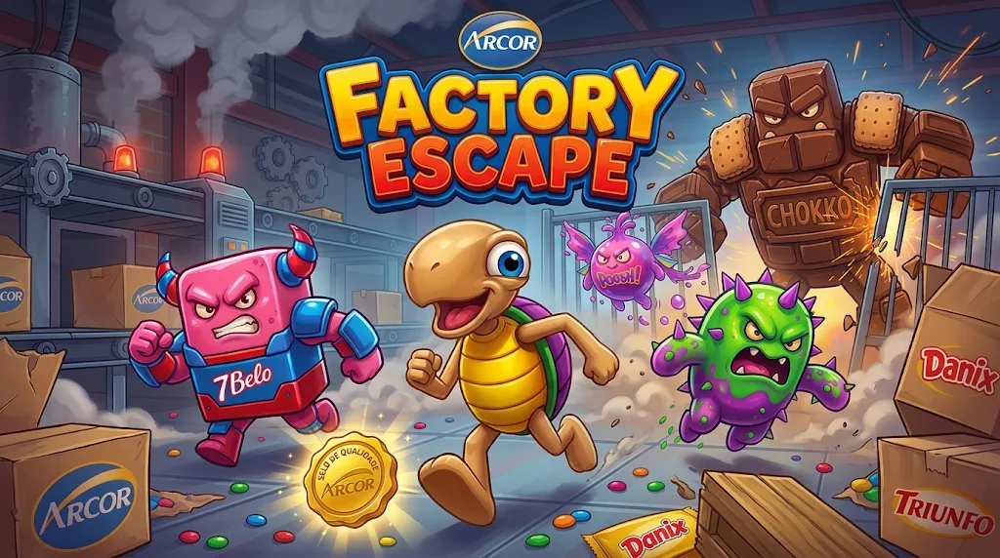

# FECAP - Fundação de Comércio Álvares Penteado

<p align="center">
<a href= "https://www.fecap.br/"></a>
</p>

# Factory Escape.

## ?Não sei?

## Integrantes: <a href="https://www.linkedin.com/in/andrepczx/">André Ananias</a>, <a href="https://www.linkedin.com/in/antonie-gabriel-204b9533b/">Antonie Gabriel</a>, <a href="https://www.linkedin.com/in/jo%C3%A3o-ferreira-a9b71839b?utm_source=share_via&utm_content=profile&utm_medium=member_ios">João Vitor</a>, <a href="https://www.linkedin.com/in/karine-vicente-87311b231?utm_source=share_via&utm_content=profile&utm_medium=member_ios">Karine Vicente </a>

## Professores Orientadores: <a href="https://www.linkedin.com/in/#/">Eduardo Savino Gomes</a>, <a href="https://www.linkedin.com/in/#/">Luis Fernando dos Santos Pires</a>, <a href="https://www.linkedin.com/in/#/">Renata Muniz Do Nascimento</a>, <a href="https://www.linkedin.com/in/#/">Robson de Oliveira Cardoso</a>, <a href="https://www.linkedin.com/in/#/">Victor Bruno Alexander Rosetti de Quiroz</a>


<p align="center">

<br>
Game by <a href="https://www.linkedin.com/in/andrepczx/">André Ananias</a>,
<a href="https://www.linkedin.com/in/antonie-gabriel-204b9533b/">Antonie Gabriel</a>,
<a href="https://www.linkedin.com/in/jo%C3%A3o-ferreira-a9b71839b/">João Vitor</a>,
<a href="https://www.linkedin.com/in/karine-vicente-87311b231/">Karine Vicente</a>.
<a href="https://creativecommons.org/licenses/by-sa/3.0/">CC BY-SA 3.0</a>
</p>

## Descrição

O **Factory Escape** é um jogo de plataforma 3D desenvolvido para aplicação prática dos conceitos de desenvolvimento de jogos. O projeto foca na utilização de mecânicas de movimentação, física, saltos e colisões, tudo ambientado em um cenário industrial temático inspirado na fábrica da Arcor.
<br><br>
A experiência é projetada para ser curta, progressiva e dinâmica, sendo dividida em três fases principais: um tutorial inicial, um desafio de parkour utilizando embalagens gigantes da 7Belo e uma intensa sequência de fuga com câmera frontal. A premissa coloca o jogador em seu primeiro dia de trabalho em uma avaliação de rotina que acaba resultando em um desastre após o colapso da caldeira principal, exigindo que o protagonista pule, desvie e corra para sobreviver e escapar da fábrica.
<br><br>

## 🛠️ Estrutura de pastas

```text
Raiz/
├── documentos/
│   ├── Entrega 1/
│   │   ├── Algoritmos e Lógica de Programação/
│   │   ├── Calculo 1/
│   │   ├── Jogos Digitais e Sistemas Digitais Interativos/
│   │   ├── Projeto Interdisciplinar - Jogos Digitais/
│   │   │   └── GDD.pdf
│   │   └── Ética e Pensamento Computacional/
│   └── Entrega 2/
├── imagens/
├── src/
│   ├── Entrega 1/
│   │   ├── Backend/
│   │   └── Frontend/
│   │       ├── Assets/
│   │       ├── Packages/
│   │       ├── ProjectSettings/
│   │       └── .gitignore
│   └── Entrega 2/
├── .gitignore
└── README.md
```

<b>README.MD</b>: Arquivo que serve como guia e explicação geral sobre nosso projeto. O mesmo que você está lendo agora.

Há também 4 pastas que seguem da seguinte forma:

<b>documentos</b>: Toda a documentação estará nesta pasta.

<b>executáveis</b>: Binários e executáveis do projeto devem estar nesta pasta.

<b>imagens</b>: Imagens do sistema

<b>src</b>: Pasta que contém o código fonte.

## 🛠 Instalação

No momento, o projeto encontra-se em fase de desenvolvimento e ainda não possui versões executáveis (APK, EXE ou HTML) disponíveis para instalação ou download. 

## 💻 Configuração para Desenvolvimento


O projeto foi desenvolvido utilizando a Unity.

Para abrir e editar o projeto é necessário:

- Unity 6.3 LTS
- Unity Hub
- Visual Studio ou outro editor compatível com C#

O projeto está localizado em:

`src/Entrega 1/Frontend`

Para executar o projeto, abra a pasta pelo Unity Hub e execute a cena `MainMenu` localizada em `Assets/Scenes` (ela leva ao tutorial e às três fases).

## 🎮 Progresso - Entrega 1

Na Entrega 1 foi desenvolvida a versão jogável completa de Factory Escape, com menu, tutorial, três fases e telas de vitória e derrota.

Funcionalidades implementadas:

**Jogador e controles**
- Movimentação com WASD e corrida com Shift
- Pulo com *coyote time* (pequena tolerância para pular logo após sair da plataforma)
- Ataque giratório da tartaruga para derrotar inimigos
- Câmera em terceira pessoa controlada pelo mouse, com ajuste para não atravessar tetos e corredores
- Sistema de vidas, dano e invencibilidade temporária
- Respawn em caso de queda e checkpoint na fase 2
- O jogador é congelado ao entrar no portal de saída, sem poder se mover, tomar dano ou cair em Game Over

**Fases e jogabilidade**
- Tutorial inicial
- Três fases (`Fabrica_Parte1`, `Fabrica_Parte2` e `Fabrica_Parte3`) ligadas por portais de saída
- Coleta de Rocklets com meta por fase (50, 30 e 110) exibida no objetivo da tela
- Obstáculos fixos e móveis, com movimento horizontal e vertical
- Área de parkour
- Baús interativos, cartão de acesso e porta final que verifica o cartão
- Inimigos e efeitos visuais de ataque e dano

**Telas e fluxo do jogo**
- Menu principal, Opções, Créditos, Game Over, Vitória e Fim de Jogo
- HUD com vidas, Rocklets e fase atual
- Menu de pausa
- Mensagens de interação e sistema de objetivos
- Fluxo entre cenas controlado pela classe `GameFlow`

**Código**
- Scripts organizados em pastas em português (`Jogador`, `Fase`, `Telas`, entre outras) e comentados

Para abrir e testar este projeto em sua máquina, você necessita da seguinte ferramenta:

- <a href="https://unity.com/download">Unity Hub / Unity Engine</a>

**Como rodar o projeto:**
1. Clone este repositório para o seu computador.
2. Abra o Unity Hub.
3. Clique em "Open" (Abrir) e navegue até a pasta `src` (ou a pasta específica do projeto Unity dentro dela) para adicioná-lo ao Hub.
4. Clique no projeto para abri-lo no editor da Unity.
5. Aguarde a importação dos *assets* e pacotes e pressione o botão de "Play" no topo da tela para testar.


## 📋 Licença/License
<a href="https://github.com/2026-2-MCC1/Projeto1">Factory Escape</a> © 2026 by <a href="https://github.com/2026-2-MCC1/Projeto1">André Ananias, Antonie Gabriel, João Vitor e Karine Vicente</a> is licensed under <a href="https://creativecommons.org/licenses/by/4.0/">CC BY 4.0</a>

## 🎓 Referências

Aqui estão as referências usadas no projeto.

1. <https://github.com/fecaphub>
